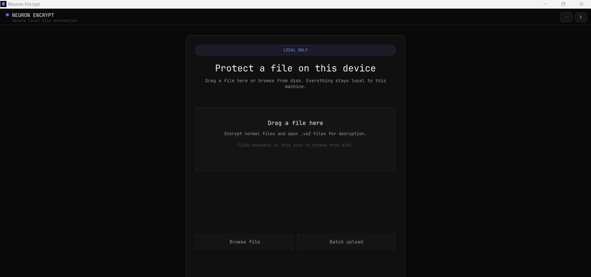
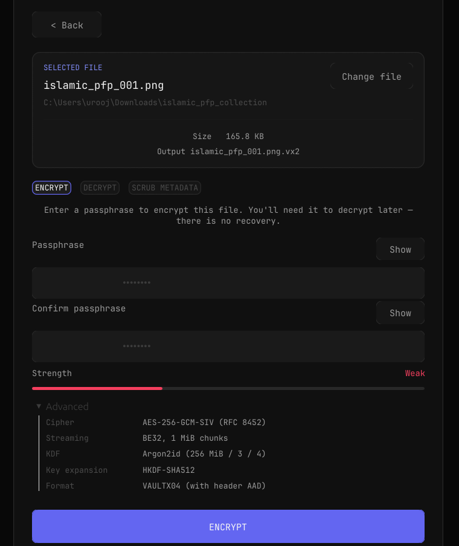
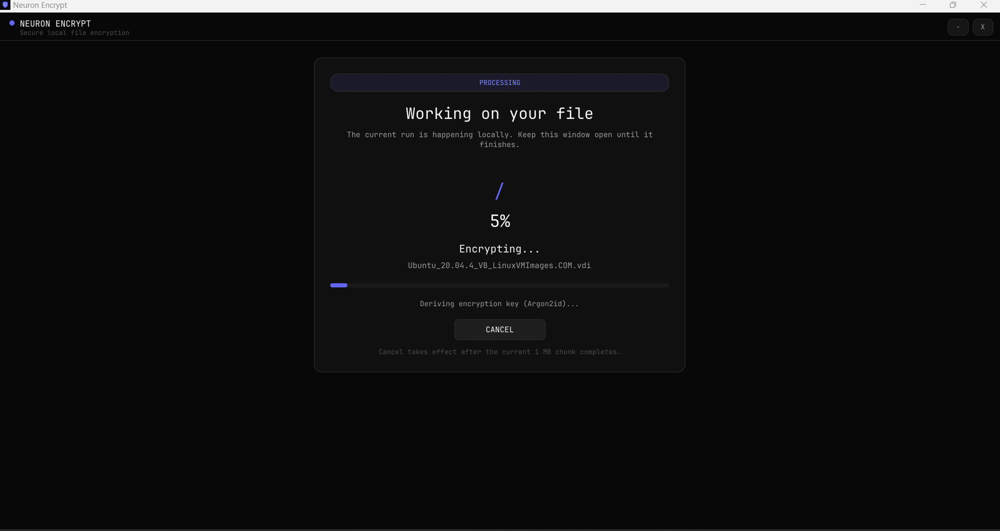
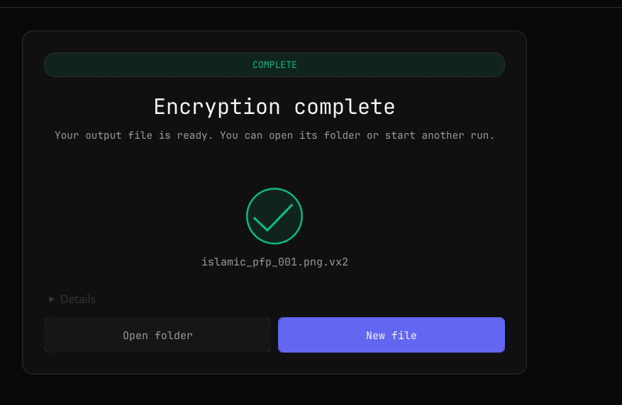

<div align="center">

# 🔒 Neuron Encrypt

**Local file encryption. No accounts. No internet. No compromise.**

AES-256-GCM-SIV · Argon2id · HKDF-SHA512 · 100% Safe Rust

[](https://gitlab.com/theredhacker0345/neuron-encrypt/releases)
[](LICENSE)
[](https://www.rust-lang.org/)
[](#download)
[](#contributing)
[](docs/SECURITY_AUDIT.md)
[](https://f-droid.org/packages/com.neuronencrypt.app/)

[**Download**](#download) · [**Website**](https://theredhacker0345.gitlab.io/neuron-encrypt/) · [**Security**](#security) · [**FAQ**](#faq)

</div>

---

<div align="center">

</div>

---

## Why Neuron Encrypt?

You have files you don't want anyone to see. Tax returns. Medical records. Source code. Photos.

**Neuron Encrypt encrypts them on your device — no cloud, no account, no phone-home.** Your passphrase never leaves your machine, and the encrypted `.vx2` file is useless to anyone without it.

| | |
|---|---|
| **🔒 Nonce-misuse resistant** | AES-256-GCM-SIV (RFC 8452) stays secure even if a nonce is ever reused |
| **🧠 Memory-hard KDF** | Argon2id at 256 MiB makes GPU brute-force prohibitively expensive |
| **🛡️ Authenticated header** | V4 authenticates the full header as AAD on every chunk, not just the body |
| **⚡ Streams any size** | 1 KB or 1 TB at a constant ~258 MB RAM (4 PiB maximum) |
| **🧽 Metadata scrubbing** | Strips EXIF/GPS, XMP, ID3 and document properties from 18 file formats |
| **🌍 4 platforms** | Windows, macOS, Linux, Android 7.0+ — one Rust codebase |
| **🔇 Offline-first** | Zero network permissions, zero telemetry, zero tracking |
| **📦 Atomic writes** | Output goes to `.tmp` first, then renames — no partial files on crash |
| **🧹 Memory hygiene** | Every key and plaintext buffer is `Zeroizing<T>`, wiped on drop |

---

## What's new in 2.3.0

**Four more scrub formats — 18 in total.** Metadata removal now covers AAC, M4A, Opus, AIFF and 3GP/3G2. Raw AAC was previously misdetected as MP3 and could not be scrubbed at all; 3GP worked but was written out with a `.mp4` extension.

**Three corruption bugs fixed.** A PNG truncated on a chunk boundary was reported as *successfully scrubbed*, and `scrub --in-place` would replace the original with a header-only stub containing no image data. WebP and GIF had the same flaw. All three now fail closed and leave the source untouched.

**Android notification fixed.** An ongoing notification could survive a finished operation and could not be swiped away — it persisted until the app was force-stopped from Settings.

**Also:** the `webbrowser` 1.2.1 advisory ([RUSTSEC-2026-0257](https://rustsec.org/advisories/RUSTSEC-2026-0257)), an in-app list of supported formats, a Linux AppImage, and a CI quality gate that runs `fmt`, `clippy -D warnings`, tests and `cargo audit` on every push.

Tests: **86/86 pass**, including 14 adversarial tests that truncate every supported container byte-by-byte and assert the source is never modified.

Full history in [CHANGELOG.md](CHANGELOG.md) · [2.3.0 release notes](docs/releases/RELEASE_NOTES_2.3.0.md)

---

## Download

No account required — everything ships through GitLab's package registry.

### Desktop

| Platform | What you get | Link |
|----------|--------------|------|
| 🐧 **Linux** | AppImage (no package manager) or `.tar.gz` with GUI + CLI | [Releases](https://gitlab.com/theredhacker0345/neuron-encrypt/releases/latest) |
| 🪟 **Windows** | `.zip` with GUI + CLI | [Releases](https://gitlab.com/theredhacker0345/neuron-encrypt/releases/latest) |
| 🍎 **macOS** | **CLI only** — Intel binary, see [macOS](#macos) below | [Releases](https://gitlab.com/theredhacker0345/neuron-encrypt/releases/latest) |

### CLI only

Prebuilt binaries, no Rust toolchain required:

| Platform | Binary |
|----------|--------|
| 🐧 Linux | [`neuron-encrypt-cli-2.3.0-linux-x86_64`](https://gitlab.com/api/v4/projects/84892701/packages/generic/neuron-encrypt-cli/2.3.0/neuron-encrypt-cli-2.3.0-linux-x86_64) |
| 🪟 Windows | [`neuron-encrypt-cli-2.3.0-windows-x86_64.exe`](https://gitlab.com/api/v4/projects/84892701/packages/generic/neuron-encrypt-cli/2.3.0/neuron-encrypt-cli-2.3.0-windows-x86_64.exe) |
| 🍎 macOS | [`neuron-encrypt-cli-2.3.0-macos-x86_64`](https://gitlab.com/api/v4/projects/84892701/packages/generic/neuron-encrypt-cli/2.3.0/neuron-encrypt-cli-2.3.0-macos-x86_64) |

**Linux / macOS** — one line, verifies SHA-256 and installs to your PATH:

```sh
curl -fsSL https://theredhacker0345.gitlab.io/neuron-encrypt/install.sh | sh
```

**Windows (PowerShell)** — verifies, installs to `%LOCALAPPDATA%\Programs\NeuronEncrypt\bin`, updates your User PATH:

```powershell
irm https://theredhacker0345.gitlab.io/neuron-encrypt/install.ps1 | iex
```

<details>
<summary>Manual install (Linux)</summary>

```bash
VERSION=2.3.0
CLI="neuron-encrypt-cli-${VERSION}-linux-x86_64"
BASE="https://gitlab.com/api/v4/projects/84892701/packages/generic/neuron-encrypt-cli/${VERSION}"

curl -fL "${BASE}/${CLI}" -o "$CLI"
curl -fL "${BASE}/SHA256SUMS-cli-linux.txt" -o SHA256SUMS-cli-linux.txt
sha256sum --check SHA256SUMS-cli-linux.txt
chmod +x "$CLI"
install -Dm755 "$CLI" "$HOME/.local/bin/neuron-encrypt-cli"
```

</details>

<details>
<summary>Install from source (needs a Rust toolchain)</summary>

`cargo install` works against **crates.io**, which is independent of any GitHub account. The published version lags the GitLab releases, so for the current version build from the repository:

```sh
git clone https://gitlab.com/theredhacker0345/neuron-encrypt.git
cd neuron-encrypt/neuron-encrypt
cargo build --release --locked --bin neuron-encrypt --bin neuron-encrypt-cli
```

`-p neuron-encrypt-cli` selects just the CLI; the repository root is a workspace containing both binaries.

</details>

### macOS

**The CLI is published for macOS. The desktop GUI is not.**

The CLI binary is cross-compiled from Linux with [osxcross](https://github.com/tpoechtrager/osxcross) against the macOS 13.3 SDK. This works because the GUI stack is behind an optional `gui` feature — building with `--no-default-features --features metadata` yields a CLI that links no AppKit, Metal or CoreFoundation frameworks, so it cross-links from Linux cleanly.

```sh
# Apple Silicon and Intel alike; falls back to x86_64 under Rosetta 2.
curl -fsSL https://theredhacker0345.gitlab.io/neuron-encrypt/install.sh | sh
neuron-encrypt-cli --version
```

**Why there is no `.app`:** the GUI is eframe/winit, which on macOS links against AppKit and Metal. A binary linked that way on Linux cannot be codesigned or notarised, and cannot be tested on real hardware from a Linux runner — so shipping one would mean handing you a file that Gatekeeper is likely to reject and that nobody has run. We would rather publish nothing than publish something we cannot stand behind.

**To build the GUI on a Mac:**

```sh
git clone https://gitlab.com/theredhacker0345/neuron-encrypt.git
cd neuron-encrypt/neuron-encrypt
cargo build --release --bin neuron-encrypt
./target/release/neuron-encrypt
```

An unsigned build runs locally; distribute it to other machines only after signing and notarising with your own Apple Developer ID.

> Apple Silicon runs the published x86_64 CLI under Rosetta 2. If Rosetta is not installed, `softwareupdate --install-rosetta` enables it. A native `aarch64-apple-darwin` build needs the osxcross toolchain to be extended for that target and is not published yet.

### Android

APK for Android 7.0+ from [GitLab releases](https://gitlab.com/theredhacker0345/neuron-encrypt/releases/latest), or via [F-Droid](https://f-droid.org/packages/com.neuronencrypt.app/). A signed build and an unsigned F-Droid build are both attached to each release.

**Always verify the SHA-256 hash** published beside each download.

---

## Screenshots

### Desktop

| Home | Configure | Processing | Success |
|------|-----------|------------|---------|
|  |  |  |  |

### Android

<div align="center">

| Home | Picker | Success | About |
|------|--------|---------|-------|
|  |  |  |  |

</div>

---

## Usage

### GUI

```bash
./neuron-encrypt
```

Drop a file (or click Browse — encrypt vs decrypt is auto-detected from magic bytes), enter a passphrase, click Encrypt. The original is left untouched; wiping it afterwards is opt-in and confirmed.

### CLI

```bash
# Encrypt (prompts for the passphrase)
neuron-encrypt-cli encrypt -i secret.pdf

# Decrypt
neuron-encrypt-cli decrypt -i secret.pdf.vx2

# Encrypt over SSH
neuron-encrypt-cli encrypt -i backup.tar.gz -o - | ssh user@host 'cat > backup.vx2'

# Machine-readable output for CI
neuron-encrypt-cli encrypt -i artifact.zip --json --password-file ./key

# Strip metadata -> writes photo.clean.jpg beside the original
neuron-encrypt-cli scrub -i photo.jpg

# Replace in place instead
neuron-encrypt-cli scrub -i video.mp4 --in-place
```

Your passphrase is held in memory only long enough to derive the key via Argon2id, then zeroed. It is never written to disk, never sent over the network, never logged.

---

## Metadata scrubbing

Strips the metadata that leaks who, where and when — without touching the file's contents.

| Family | Formats | What gets removed |
|--------|---------|-------------------|
| Images | JPEG, PNG, WebP, GIF, TIFF, BMP | EXIF + GPS, XMP, IPTC, Photoshop blocks, ICC profiles, comments, timestamps |
| Documents | PDF, Office (`docx`/`xlsx`/`pptx`) | Author/title/dates, XMP streams, `docProps/*`, embedded thumbnails |
| Audio | MP3, AAC, M4A, FLAC, OGG, Opus, WAV, AIFF | ID3v1/v2, APE tags, iTunes `ilst`, Vorbis comments, RIFF INFO, IFF text chunks |
| Video | MP4, MOV, 3GP, 3G2 | iTunes `ilst` atoms, GPS, device and encoder tags |

**Fail closed.** A scrubber that does not fully understand a structure aborts with an explicit error rather than emitting a possibly-broken file, and every output is re-validated before it replaces anything. Unknown formats, plain ZIPs, archives and camera RAW are rejected. **HEIC/HEIF is detected but deliberately not rewritten** — its GPS and device data live in structures whose offsets point into the media payload, and guessing risks corrupting the photo.

Other guarantees:

- **Cleaned copy by default** — `<name>.clean.<ext>` is written atomically beside the original. In-place replacement and post-copy secure wipe are opt-in.
- **Payload integrity** — retained chunks are copied byte-for-byte, so decoders see identical data.
- **Bounded memory on mobile** — the Android engine stages files through app-private storage with a fixed 1 MiB buffer. Formats that must be parsed whole are capped at 64 MiB on Android (1 GiB on desktop) and report "too large to scrub" rather than being killed.

---

## Security

| Layer | Algorithm | Parameters |
|-------|-----------|------------|
| Encryption | AES-256-GCM-SIV (RFC 8452) | BE32 streaming, 1 MiB chunks, per-chunk auth tag |
| Key derivation | Argon2id (RFC 9106) | m=256 MiB, t=3, p=4, 64-byte output |
| Key expansion | HKDF-SHA512 (RFC 5869) | Per-version domain separation (V2/V3/V4) |
| Randomness | OsRng (OS CSPRNG) | Fresh salt + nonce per file, never reused |
| Memory hygiene | `Zeroizing<T>` | Keys + plaintext wiped from RAM on drop |
| File format | VAULTX04 | Header authenticated as AAD on every chunk |

**Protected against:** offline brute-force, ciphertext tampering, header tampering, nonce reuse, truncation/reordering/substitution, and plaintext lingering in RAM.

**Not protected against:** cold-boot and DMA attacks, keyloggers and screen recorders, SSD wear-leveling (secure wipe is best-effort on flash), weak passphrases (the strength meter is advisory), and metadata leakage — filenames, sizes and timestamps stay visible.

Full audit: 44 findings, 0 critical, 0 high, 9 medium (all fixed). See [SECURITY_AUDIT.md](docs/SECURITY_AUDIT.md).

**Found a vulnerability?** Do not open a public issue — use a [GitLab confidential issue](https://gitlab.com/theredhacker0345/neuron-encrypt/-/issues/new?issue[confidential]=true).

---

## FAQ

<details>
<summary><b>Can I recover my files if I forget the passphrase?</b></summary>

No. There is no backdoor, no recovery key, no master password. This is by design — a backdoor that lets you in also lets an attacker in.
</details>

<details>
<summary><b>Is my passphrase stored anywhere?</b></summary>

No. It is held in memory only long enough to derive the key via Argon2id, then zeroed. Never written to disk, never sent over the network, never logged.
</details>

<details>
<summary><b>What is the difference between V2, V3 and V4?</b></summary>

- **V2 (VAULTX02)** — legacy, entire file in RAM, ≤1 GiB
- **V3 (VAULTX03)** — streaming, 1 MiB chunks, no size limit, header **not** authenticated
- **V4 (VAULTX04)** — current default: same as V3, but the header is authenticated as AAD on every chunk

All three are readable by v2.1+. New encryptions use V4. There is no auto-migration — re-encrypt to upgrade.
</details>

<details>
<summary><b>How does this compare to VeraCrypt / Cryptomator / 7-Zip?</b></summary>

| Feature | Neuron Encrypt | VeraCrypt | Cryptomator | 7-Zip AES |
|---------|---------------|-----------|-------------|-----------|
| Scope | File-level | Volume/container | Cloud-file | File-level |
| Cipher | AES-256-GCM-SIV | AES-256-XTS | AES-256-GCM | AES-256 |
| Nonce-misuse resistant | ✅ | ❌ | ❌ | ❌ |
| KDF | Argon2id 256 MiB | PBKDF2 | PBKDF2 | PBKDF2 |
| Authenticated header | ✅ (V4) | ❌ | ❌ | ❌ |
| Memory-hard KDF | ✅ | ❌ | ❌ | ❌ |
| RAM usage | ~258 MB | Varies | Low | Low |
| Max file size | 4 PiB | 16 EiB | Unlimited | Unlimited |
| Metadata scrubbing | ✅ 18 formats | ❌ | ❌ | ❌ |
| Open source | ✅ GPLv3 | ✅ | ✅ | ✅ |

</details>

<details>
<summary><b>Is macOS supported?</b></summary>

The **CLI** is — an Intel binary, cross-compiled and published with every release, installable with the same one-liner as Linux. Apple Silicon runs it under Rosetta 2.

The **GUI** is not, and we are not shipping an unverifiable one. The desktop app links against AppKit and Metal, so a binary cross-linked from a Linux runner can be neither codesigned, nor notarised, nor tested on real hardware — and an unsigned `.app` is something Gatekeeper usually refuses. Build it yourself from source on your Mac if you want the windowed app; the exact command is in [macOS](#macos).
</details>

<details>
<summary><b>Why is the Windows build not code-signed?</b></summary>

Authenticode certificates cost $200–400/year. Until one is available, SmartScreen will warn on first run — click "Run anyway", and verify the SHA-256 hash published with the download.
</details>

<details>
<summary><b>What are the CLI limitations?</b></summary>

- **No stdin encrypt / scrub** — both need seeking, so piped input is decrypt-only
- **Fixed Argon2id parameters** — no `--memory-cost` / `--time-cost` flags, by design
- **No batch or glob mode** — single file per invocation; loop with `find -exec` (the GUI and Android app do support batch)
- **No `--dry-run`**

</details>

<details>
<summary><b>Can I install the CLI from crates.io?</b></summary>

Yes, `cargo install neuron-encrypt-cli` works and needs no account. Note the published version lags the GitLab releases — check the badge at the top for the current one.
</details>

---

## Contributing

```bash
git clone https://gitlab.com/theredhacker0345/neuron-encrypt.git
cd neuron-encrypt/neuron-encrypt
rustup component add rustfmt clippy

cargo fmt --check
cargo clippy --all-targets --all-features -- -D warnings
cargo test --lib --release
```

The same three commands run as a CI quality gate on every push. Pipeline details are in [docs/CI_CD.md](docs/CI_CD.md).

| Path | |
|------|--|
| `neuron-encrypt/src/crypto.rs` | AES-256-GCM-SIV, Argon2id, V2/V3/V4 formats |
| `neuron-encrypt/src/metadata/` | Metadata scrubbing, one module per family |
| `neuron-encrypt/src/metadata/brutal.rs` | Adversarial tests (truncation sweep, hostile inputs) |
| `neuron-encrypt/src/gui.rs` | egui desktop GUI |
| `neuron-encrypt/src/bin/cli.rs` | CLI binary |
| `android/` | Kotlin app + Rust JNI bridge |
| `.gitlab/ci/` | Per-platform child pipelines |

---

## License

GPLv3 — Copyright (c) 2024–2026 Ubaid ur Rehman. See [LICENSE](LICENSE).

---

<div align="center">

**[Download](#download)** · **[Website](https://theredhacker0345.gitlab.io/neuron-encrypt/)** · **[Security](#security)** · **[FAQ](#faq)**

Made with Rust · No tracking · No cookies · No analytics

</div>
