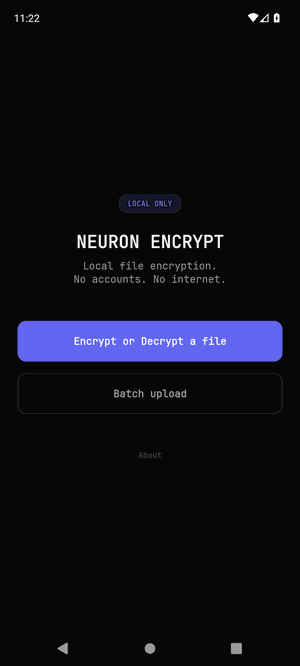
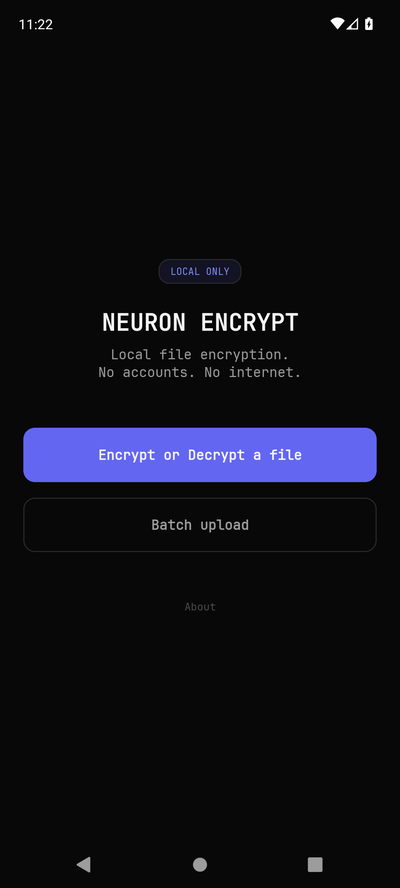
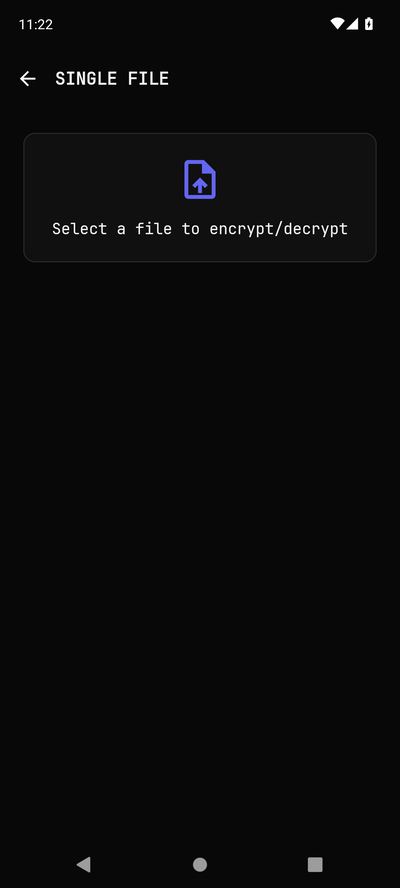
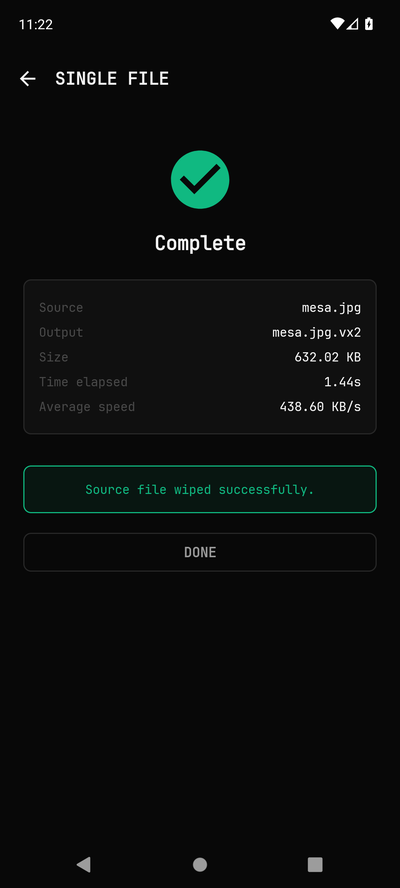
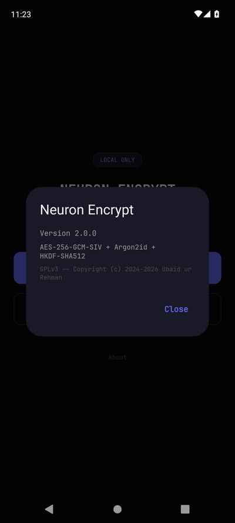

<div align="center">

# 🔒 Neuron Encrypt

**Local file encryption. No accounts. No internet. No compromise.**

AES-256-GCM-SIV · Argon2id · HKDF-SHA512 · 100% Safe Rust

[](https://gitlab.com/theredhacker0345/neuron-encrypt/releases)
[](LICENSE)
[](https://www.rust-lang.org/)
[](https://crates.io/crates/neuron-encrypt)
[](https://f-droid.org/packages/com.neuronencrypt.app/)
[](#download)
[](#security)
[](SECURITY_AUDIT.md)

[**Download**](#download) · [**Website**](https://theredhacker0345.gitlab.io/neuron-encrypt/) · [**Security**](#security) · [**Docs**](#how-it-works) · [**FAQ**](#faq)

</div>

---

<div align="center">



</div>

---

## Why Neuron Encrypt?

You have files you don't want anyone to see. Tax returns. Medical records. Source code. Photos.

**Neuron Encrypt encrypts them on your device — no cloud, no account, no phone-home.** Your passphrase never leaves your machine. The encrypted `.vx2` file is useless to anyone who doesn't have the passphrase.

- **🔒 Nonce-misuse resistant** — AES-256-GCM-SIV (RFC 8452) stays secure even if nonce reuse happens
- **🧠 Memory-hard KDF** — Argon2id at 256 MiB makes GPU brute-force prohibitively expensive
- **🛡️ Authenticated header** — V4 format verifies the full header on every chunk (not just the body)
- **⚡ Stream any size** — 1 KB or 1 TB, constant ~258 MB RAM, up to 4 PiB max
- **🧹 Memory hygiene** — Every key and plaintext buffer is `Zeroizing<T>`, wiped on drop
- **🌍 4 platforms** — Windows, macOS, Linux, Android 7.0+ (all from one Rust codebase)
- **🔇 Offline-first** — Zero network permissions on Android, zero telemetry, zero tracking
- **📦 Atomic writes** — Output goes to `.tmp` first, then renames. No partial files on crash
- **🧽 Metadata scrubbing** — Remove EXIF/GPS, XMP, IPTC, ID3 and document properties from JPEG, PNG, WebP, GIF, TIFF, BMP, PDF, Office, MP3, FLAC, OGG, WAV and MP4 files

---

## What's new in 2.2.0

- **New: metadata scrubbing on every platform** — strip EXIF/GPS, XMP, IPTC, ID3 tags and document properties from photos, PDFs, office documents and audio/video files. One Rust engine powers the GUI (new **Scrub** mode), the CLI (`neuron-encrypt-cli scrub`), and the Android app (new **Scrub** tab, single-file and batch).
- **Cleaned copies, never surprises** — output is written atomically as `photo.clean.jpg` beside your original; the source is never modified unless you explicitly ask for in-place replacement. Unsupported formats are rejected loudly instead of being copied silently.
- **Flat memory profile** — the Android engine stages files through app-private cache storage with a fixed 1 MiB buffer (never loads whole files into RAM), guarded by a free-space check before it starts.
- **Fixed**: an Android bug where cancelling during a chunk write could hang the worker (latent since 2.1.2), and an fd-leak edge case when the destination picker throws.

---

## What's new in 2.1.2

- **Fixed: empty files from Drive/cloud storage** — Android no longer detaches the file descriptor before encryption finishes, so files from remote storage (Drive, etc.) come out intact instead of 0 bytes. Native code now duplicates the fd and owns its own copy, so the app can never report "done" while data is still being flushed.
- **Cleaner Android back navigation** — the new predictive-back callback is enabled, removing a warning in recent Android versions.

---

## What's new in 2.1.1

- **No more hangs on older phones** — crypto runs on a background dispatcher and provider metadata lookups (`getFileInfo` / `detectMagicBytes`) moved off the UI thread, so slow/remote storage (e.g. Drive) can't freeze or ANR the app.
- **100% means done** — the Android JNI `fsync`s before reporting completion, so the app never claims finished while data is still being written back to slow storage.
- **Batch survives backgrounding** — batch operations now run under a foreground service with notification progress, just like single-file operations.
- **Cleaner cancel UX** — cancelling shows a neutral "Operation cancelled" notice instead of a red error.
- **Tighter passphrase hygiene** — passphrase byte arrays are zeroed in `finally` on top of the native-side zeroing.

---

## Download

| Platform | Type | Link |
|----------|------|------|
| 🪟 Windows | x86_64 GUI + CLI ZIP | [GitLab packages ↗](https://gitlab.com/theredhacker0345/neuron-encrypt/-/packages) |
| 🍎 macOS | x86_64 GUI + CLI archive; Apple Silicon build is best-effort | [GitLab packages ↗](https://gitlab.com/theredhacker0345/neuron-encrypt/-/packages) |
| 🐧 Linux | x86_64 GUI + CLI archive | [Download from GitLab Package Registry ↗](https://gitlab.com/theredhacker0345/neuron-encrypt/-/packages) |
| 🤖 Android | APK (Android 7.0+) | [Latest release ↗](https://gitlab.com/theredhacker0345/neuron-encrypt/releases/latest) |
| 🖥️ Desktop GUI | Built alongside the CLI on Linux, Windows, and macOS | Use the platform archive above |
| ⌨️ Linux CLI | Standalone x86_64 binary | [Direct GitLab download ↗](https://gitlab.com/api/v4/projects/84892701/packages/generic/neuron-encrypt-cli/2.2.0/neuron-encrypt-cli-2.2.0-linux-x86_64) |
| ⌨️ Windows CLI | Standalone x86_64 `.exe` | [Direct GitLab download ↗](https://gitlab.com/api/v4/projects/84892701/packages/generic/neuron-encrypt-cli/2.2.0/neuron-encrypt-cli-2.2.0-windows-x86_64.exe) |
| ⌨️ macOS CLI | Standalone Intel binary | [Direct GitLab download ↗](https://gitlab.com/api/v4/projects/84892701/packages/generic/neuron-encrypt-cli/2.2.0/neuron-encrypt-cli-2.2.0-macos-x86_64) |

**No account is required.** The GUI+CLI archives and standalone CLI binaries are published through GitLab’s Generic Package Registry, so users do not need a Cargo account, GitHub account, or GitHub sign-in. The Linux and Windows CLI links above are live for version `2.2.0`; the macOS link becomes live when the macOS packaging job publishes its archive.

For Linux, install the standalone CLI into your user path:

```bash
VERSION=2.2.0
CLI_FILE="neuron-encrypt-cli-${VERSION}-linux-x86_64"
curl -fL "https://gitlab.com/api/v4/projects/84892701/packages/generic/neuron-encrypt-cli/${VERSION}/${CLI_FILE}" -o "$CLI_FILE"
curl -fL "https://gitlab.com/api/v4/projects/84892701/packages/generic/neuron-encrypt-cli/${VERSION}/SHA256SUMS-cli-linux.txt" -o SHA256SUMS-cli-linux.txt
sha256sum --check SHA256SUMS-cli-linux.txt
chmod +x "$CLI_FILE"
install -Dm755 "$CLI_FILE" "$HOME/.local/bin/neuron-encrypt-cli"
neuron-encrypt-cli --help
```


On Windows, download the `.exe` link and run `neuron-encrypt-cli-2.2.0-windows-x86_64.exe --help`. Its checksum is available at [SHA256SUMS-cli-windows.txt](https://gitlab.com/api/v4/projects/84892701/packages/generic/neuron-encrypt-cli/2.2.0/SHA256SUMS-cli-windows.txt). On macOS Intel, download the macOS CLI link when it is published, run `chmod +x neuron-encrypt-cli-2.2.0-macos-x86_64`, and execute it with `./neuron-encrypt-cli-2.2.0-macos-x86_64 --help`. Apple Silicon users should use the macOS archive until a native universal CLI package is published.

**Verify your download:** SHA-256 hashes are published with each package and in the [release notes](https://gitlab.com/theredhacker0345/neuron-encrypt/releases). Standalone CLI checksums are published beside the binaries as `SHA256SUMS-cli-linux.txt`, `SHA256SUMS-cli-windows.txt`, and `SHA256SUMS-cli-macos.txt` when the corresponding platform package is published.

---

## Screenshots

<div align="center">

<!-- Animated demo GIF — cycles through all 4 screens -->


*Neuron Encrypt in action — Home → File Selection → Encryption Complete → About*

<!-- Static screenshots with proper sizing via HTML img tags -->
<table>
  <tr>
    <td align="center"><br/><sub>Home</sub></td>
    <td align="center"><br/><sub>File Selection</sub></td>
    <td align="center"><br/><sub>Encryption Complete</sub></td>
    <td align="center"><br/><sub>About</sub></td>
  </tr>
</table>

*Android app — dark theme, Material 3*

</div>

---

## How it works

```
┌─────────────────────────────────────────────────────────┐
│  Your file  ──►  Passphrase  ──►  AES-256-GCM-SIV  ──►  .vx2  │
└─────────────────────────────────────────────────────────┘
```

1. **Drop a file** — or click Browse. Auto-detects encrypt vs decrypt from magic bytes.
2. **Enter a passphrase** — strength meter gives instant feedback.
3. **Click ENCRYPT** — file streams through 1 MiB chunks, written atomically to `.vx2`.
4. **Done** — original is untouched. Optionally wipe it (with confirmation).

Your passphrase is held in memory only long enough to derive the key via Argon2id, then zeroed. It's never written to disk, never sent over network, never logged.

---

## Metadata scrubbing (new in 2.2.0)

Scrubbing removes the metadata that leaks who/where/when — without touching your file's contents.

| Family | Formats | What gets removed |
|--------|---------|-------------------|
| Images | JPEG, PNG, WebP, GIF, TIFF, BMP | EXIF + GPS, XMP, IPTC, Photoshop blocks, ICC profiles, comments, timestamps |
| Documents | PDF, Office (`docx`/`xlsx`/`pptx`) | Author/title/dates Info dictionary, XMP streams, `docProps/*`, embedded thumbnails |
| Audio | MP3, FLAC, OGG, WAV | ID3v1/v2, APE tags, Vorbis comments, RIFF INFO |
| Video | MP4/MOV | iTunes/`ilst` atoms |

Guarantees:

- **Cleaned copy by default** — `<name>.clean.<ext>` is written atomically beside your file; the original is untouched. In-place replacement and post-copy secure wipe are opt-in.
- **Fail closed** — unrecognized formats return an explicit error. A scrubber that can't understand a structure aborts rather than emitting a possibly-broken file; every output is re-validated before it replaces anything.
- **Payload integrity** — kept chunks/segments are copied byte-for-byte, so decoders see identical image/audio data. Tests verify pixels survive TIFF relocation and CRCs stay valid.
- **Bounded memory on mobile** — the Android engine stages files through app-private cache storage with a fixed 1 MiB buffer; peak RAM does not grow with file size.
- **Not for HEIC yet** — HEIF/HEIC files are detected but rejected with guidance rather than riskily rewritten.

---

## Security

### Cipher suite

| Layer | Algorithm | Parameters |
|-------|-----------|------------|
| Encryption | AES-256-GCM-SIV (RFC 8452) | BE32 streaming, 1 MiB chunks, per-chunk auth tag |
| Key derivation | Argon2id (RFC 9106) | m=256 MiB, t=3, p=4, 64-byte output |
| Key expansion | HKDF-SHA512 (RFC 5869) | Per-version domain separation (V2/V3/V4) |
| Randomness | OsRng (OS CSPRNG) | Fresh salt + nonce per file, never reused |
| Memory hygiene | `Zeroizing<T>` | Keys + plaintext wiped from RAM on drop |
| File format | VAULTX04 | Header authenticated as AAD on every chunk |

### Threat model

**Protected against:**
- ✅ Offline brute-force (Argon2id 256 MiB memory cost)
- ✅ Ciphertext tampering (per-chunk GCM-SIV authentication tags)
- ✅ Header tampering (V4 AAD authenticates magic + salt + nonce)
- ✅ Nonce reuse (GCM-SIV is misuse-resistant; fresh random nonce per file)
- ✅ Truncation, reordering, substitution attacks (BE32 counter + flag binding)
- ✅ Plaintext lingering in RAM (`Zeroizing<T>` on all secret buffers)

**Not protected against:**
- ❌ Cold-boot / DMA attacks (no in-memory encryption)
- ❌ Keyloggers and screen recorders
- ❌ SSD wear-leveling (secure wipe is best-effort on flash storage)
- ❌ Weak passphrases (strength meter is advisory, not enforced)
- ❌ Metadata leakage (file names, sizes, timestamps are visible)

**Full audit:** 44 findings, 0 CRITICAL, 0 HIGH, 9 MEDIUM (all fixed), 10 LOW, 25 INFO. See [SECURITY_AUDIT.md](SECURITY_AUDIT.md) and [CHANGELOG.md](CHANGELOG.md).

---

## Quick start

### Install

#### Recommended: download the Linux archive

This is the easiest option for Linux Mint. It does not require Rust, Cargo, a Cargo account, or GitHub authentication.

1. Open the [Neuron Encrypt GitLab packages](https://gitlab.com/theredhacker0345/neuron-encrypt/-/packages) page and choose the version you want.
2. Download the Linux `.tar.gz` package and its checksum file.
3. Verify the archive, extract it, and install the binaries locally:

```bash
VERSION=2.2.0
ARCHIVE="neuron-encrypt-${VERSION}-linux-x86_64.tar.gz"

# Download SHA256SUMS-linux.txt beside the archive, then verify the archive.
sha256sum "$ARCHIVE"
# Compare the output with the matching archive entry in SHA256SUMS-linux.txt.

tar -xzf "$ARCHIVE"
install -Dm755 "neuron-encrypt-${VERSION}-linux-x86_64/neuron-encrypt" "$HOME/.local/bin/neuron-encrypt"
install -Dm755 "neuron-encrypt-${VERSION}-linux-x86_64/neuron-encrypt-cli" "$HOME/.local/bin/neuron-encrypt-cli"
```

Compare the printed SHA-256 value with the matching entry in `SHA256SUMS-linux.txt` before running the binaries. Start a new terminal if `~/.local/bin` is not already on your `PATH`.

#### Optional: build from source

A Cargo account is **not** needed for a normal public dependency download. If you prefer a local build, Linux Mint users can use the distribution packages instead of installing `rustup`:

```bash
sudo apt update
sudo apt install --yes cargo rustc build-essential pkg-config libssl-dev

git clone https://gitlab.com/theredhacker0345/neuron-encrypt.git
cd neuron-encrypt
cargo build --release --locked --bin neuron-encrypt --bin neuron-encrypt-cli
```

The resulting files are `neuron-encrypt/target/release/neuron-encrypt` and `neuron-encrypt/target/release/neuron-encrypt-cli`. This build path is optional; most users should use the prebuilt GitLab archive above.

#### Remove only this source build

A source build does not require removing Rust from the whole system. To reclaim the space used by this checkout, run the following from the repository directory:

```bash
cargo clean
cd ..
rm -rf neuron-encrypt
```

These commands remove only this project’s `target/` directory and checkout. They do not remove Cargo, Rust, or other Rust projects. If you installed Rust only for Neuron Encrypt through `rustup`, you may later run `rustup self uninstall`; otherwise keep the toolchain for your other projects.

### GUI

```bash
./target/release/neuron-encrypt
```

### CLI

```bash
# Encrypt (interactive prompt)
neuron-encrypt-cli encrypt -i secret.pdf

# Decrypt
neuron-encrypt-cli decrypt -i secret.pdf.vx2

# Pipe over SSH
neuron-encrypt-cli encrypt -i backup.tar.gz -o - | ssh user@host 'cat > backup.vx2'

# JSON output for CI/CD
neuron-encrypt-cli encrypt -i artifact.zip --json --password-file /secrets/key

# Strip metadata (writes photo.clean.jpg beside the original)
neuron-encrypt-cli scrub -i photo.jpg

# Scrub in place instead, with machine-readable output
neuron-encrypt-cli scrub -i video.mp4 --in-place --json
```

### Android

Download the APK from [releases](https://gitlab.com/theredhacker0345/neuron-encrypt/releases) or build with the [JNI toolchain](android/README.md). Minimum: Android 7.0 (API 24).

### Run tests

```bash
cargo test --lib --release
```

---

## FAQ

<details>
<summary><b>Can I recover my files if I forget the passphrase?</b></summary>

No. There is no backdoor, no recovery key, no master password. If you forget the passphrase, the files are gone. This is by design — a backdoor that lets you in also lets an attacker in.
</details>

<details>
<summary><b>Is my passphrase stored anywhere?</b></summary>

No. The passphrase is held in memory only long enough to derive the encryption key via Argon2id, then it's zeroed. It's never written to disk, never sent over the network, never logged.
</details>

<details>
<summary><b>What's the difference between V2, V3, and V4 formats?</b></summary>

- **V2 (VAULTX02)** — legacy single-shot format, entire file in RAM, ≤1 GiB
- **V3 (VAULTX03)** — streaming format, 1 MiB chunks, no size limit, header NOT authenticated
- **V4 (VAULTX04)** — current default, same as V3 but with header authenticated as AAD on every chunk

All three are readable by v2.1. New encryptions use V4. There is no auto-migration — re-encrypt to upgrade.
</details>

<details>
<summary><b>Why is the binary not code-signed?</b></summary>

Windows is the only platform that requires code signing, and Authenticode certificates cost $200-400/year. Signing is planned once F-Droid distribution is established. For now, Windows SmartScreen will warn on first install — click "Run anyway". Always verify the SHA-256 hash in the release notes against your download.
</details>

<details>
<summary><b>How does this compare to VeraCrypt / Cryptomator / 7-Zip?</b></summary>

| Feature | Neuron Encrypt | VeraCrypt | Cryptomator | 7-Zip AES |
|---------|---------------|-----------|-------------|-----------|
| Scope | File-level | Volume/container | Cloud-file | File-level |
| Cipher | AES-256-GCM-SIV | AES-256-XTS | AES-256-GCM | AES-256 |
| Nonce-misuse resistant | ✅ | ❌ | ❌ | ❌ |
| KDF | Argon2id 256 MiB | PBKDF2 | PBKDF2 | PBKDF2 |
| Authenticated header | ✅ (V4) | ❌ | ❌ | ❌ |
| Memory-hard | ✅ | ❌ | ❌ | ❌ |
| RAM usage | ~258 MB | Varies | Low | Low |
| Max file size | 4 PiB | 16 EiB | Unlimited | Unlimited |
| Cross-platform | ✅ 4 platforms | ✅ | ✅ | ✅ |
| Open source | ✅ GPLv3 | ✅ | ✅ | ✅ |
</details>

<details>
<summary><b>Is there a CLI?</b></summary>

Yes — `neuron-encrypt-cli` ships with the desktop build. Supports piping, JSON output, password files, shell completions, and exit codes for scripting. See [CLI usage](#quick-start) above.
</details>

<details>
<summary><b>How do I report a vulnerability?</b></summary>

**Do NOT open a public issue.** Use the [GitLab confidential issue](https://gitlab.com/theredhacker0345/neuron-encrypt/-/issues/new?issue[confidential]=true) to report privately. We'll acknowledge within 48 hours and work with you on a fix before public disclosure.
</details>

<details>
<summary><b>What are the CLI limitations?</b></summary>

- **No stdin encrypt / scrub** — both require seeking, so piped input is decrypt-only for now
- **Argon2id params are fixed** — no `--memory-cost` / `--time-cost` flags (set by design)
- **No batch/glob mode** — single-file only; use `find -exec` or a loop for batch (the GUI and Android app support batch scrubbing)
- **No `--dry-run`** — no preview without processing
- **No password generation flag** — use a password manager
</details>

---


## Project structure

```
Neuron-Encrypt/
├── neuron-encrypt/          # Rust core (crypto + metadata + GUI + CLI)
│   ├── src/crypto.rs        # AES-256-GCM-SIV, Argon2id, V2/V3/V4 formats
│   ├── src/metadata/        # Metadata scrubbing (EXIF/GPS/XMP/ID3/docProps)
│   ├── src/gui.rs           # egui desktop GUI
│   ├── src/bin/cli.rs       # CLI binary
│   └── Cargo.toml
├── android/                 # Android app (Kotlin + Rust JNI)
│   ├── app/                 # Compose Material3 UI
│   ├── neuron-encrypt-jni/  # Rust JNI bridge
│   └── build-rust.sh        # Cross-compile 4 ABIs
├── installer/               # NSIS Windows installer
├── docs/                    # Website (GitLab Pages)
├── fastlane/                # F-Droid metadata
├── SECURITY_AUDIT.md        # Full audit report (44 findings)
├── CHANGELOG.md             # Version history
└── README.md                # This file
```

---

## Contributing

Bug reports and pull requests welcome. For security vulnerabilities, use [GitLab confidential issue](https://gitlab.com/theredhacker0345/neuron-encrypt/-/issues/new?issue[confidential]=true) instead of a public issue.

```bash
rustup component add rustfmt clippy
cargo fmt --check
cargo clippy --all-targets -- -D warnings
cargo test --lib --release
```

See [CLI_IMPROVEMENT_PLAN.md](CLI_IMPROVEMENT_PLAN.md) for the post-review improvement backlog.

---

## Distribution
| Channel | Package | Status |
|---------|---------|--------|
| [GitLab Package Registry](https://gitlab.com/theredhacker0345/neuron-encrypt/-/packages) | GUI + CLI archives and standalone CLI binaries for desktop platforms | ✅ Recommended; no account required |
| [GitLab Releases](https://gitlab.com/theredhacker0345/neuron-encrypt/releases) | Release notes, source archives, and platform assets | ✅ Published; platform assets depend on the completed packaging job |
| [crates.io](https://crates.io/crates/neuron-encrypt) | `neuron-encrypt` core + `neuron-encrypt-cli` CLI | ✅ Developer channel; login is not required to install public crates |
| [F-Droid](https://f-droid.org/packages/com.neuronencrypt.app/) | Android APK | ⏳ Pending submission |
| [Homebrew](https://brew.sh) | `neuron-encrypt` formula | ❓ Planned if there is demand |
| AppImage / Snap / Scoop | — | ❓ Future packaging options; direct GitLab packages are the current easiest desktop path |

---

## License

GPLv3 — Copyright (c) 2024–2026 Ubaid ur Rehman. See [LICENSE](LICENSE) for full text.

---

<div align="center">

**[Download](#download)** · **[Website](https://theredhacker0345.gitlab.io/neuron-encrypt/)** · **[Security](#security)** · **[FAQ](#faq)**

Made with Rust · No tracking · No cookies · No analytics

</div>
